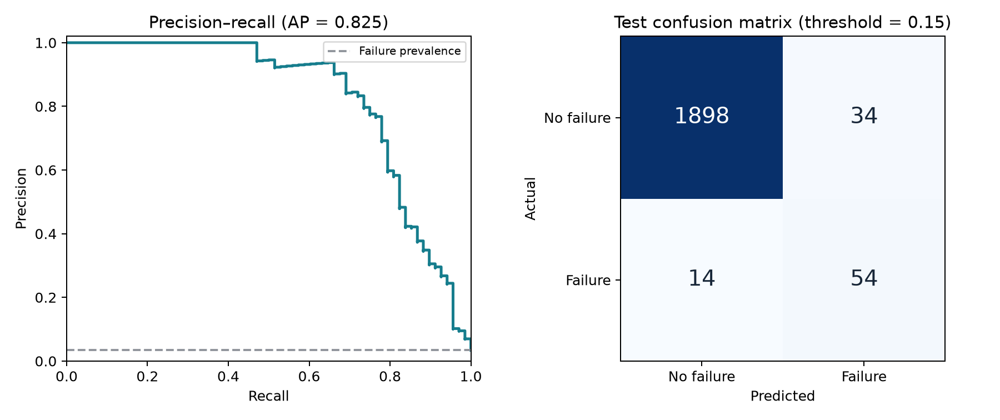
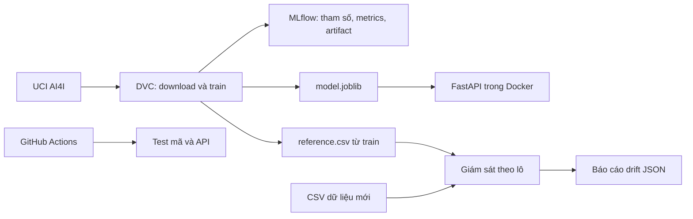
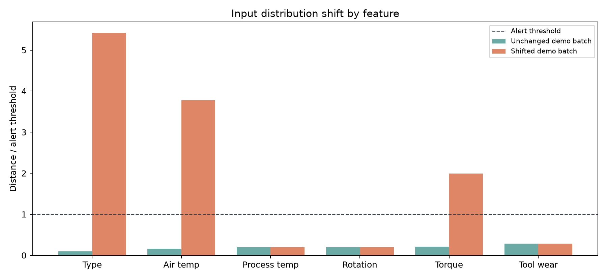

# BÁO CÁO DỰ ÁN MÔN VẬN HÀNH HỆ THỐNG HỌC MÁY

## MLOps Pipeline for Predictive Maintenance

| Mã số sinh viên | Họ và tên |
| --- | --- |
| 20250386E | Lương Trung Kiên |
| 20241617E | Hà Vĩnh Phước |
| 20260079E | Nguyễn Văn Tuấn Tú |

Repository: [kienluongzero-hue/MLops](https://github.com/kienluongzero-hue/MLops). Đây là bản nháp nội dung; nhóm có thể bổ sung tên lớp, giảng viên và định dạng theo yêu cầu nộp cuối kỳ.

## Tóm tắt

Dự án xây dựng quy trình vận hành cho bài toán phân loại trạng thái hỏng máy từ dữ liệu cảm biến mô phỏng AI4I 2020. Quy trình gồm tải và kiểm tra dữ liệu, chia train/validation/test, huấn luyện ba mô hình, ghi thí nghiệm bằng MLflow, quản lý pipeline bằng DVC, xuất mô hình được chọn, phục vụ dự đoán qua FastAPI và Docker, kiểm thử tự động bằng GitHub Actions, cùng bước giám sát thay đổi phân phối dữ liệu đầu vào theo lô. XGBoost đạt PR-AUC 0,825, precision 0,614 và recall 0,794 trên tập test 2.000 bản ghi. Kết quả mô tả hiệu quả trên bộ dữ liệu mô phỏng, chưa chứng minh khả năng triển khai trong nhà máy thật.

## 1. Đặt vấn đề và mục tiêu

Sự cố máy móc có thể gây gián đoạn sản xuất. Dữ liệu cảm biến cung cấp một cách mô tả trạng thái vận hành của thiết bị. Mục tiêu học máy của dự án là ước lượng xác suất máy **đang ở trạng thái hỏng** tại bản ghi đầu vào. Mục tiêu môn học là biến mô hình thành một quy trình có thể tái tạo, kiểm tra, phục vụ và giám sát, thay vì chỉ dừng ở một notebook huấn luyện.

Các đầu ra cụ thể gồm: `dvc.yaml` và `dvc.lock` cho pipeline, thí nghiệm MLflow, artifact mô hình, API `/predict`, Docker image, bài test, báo cáo drift và bằng chứng đánh giá có thể tạo lại. Phạm vi này không bao gồm dự báo thời gian còn lại trước khi hỏng (remaining useful life).

## 2. Dữ liệu và chuẩn bị đầu vào

Nhóm sử dụng [AI4I 2020 Predictive Maintenance Dataset](https://archive.ics.uci.edu/dataset/601/ai4i) từ UCI Machine Learning Repository, DOI [10.24432/C5HS5C](https://doi.org/10.24432/C5HS5C). Bộ dữ liệu có 10.000 bản ghi mô phỏng; tỷ lệ nhãn `Machine failure = 1` là 3,39%. Bản CSV được tải bằng script từ UCI và được nhận diện bằng SHA-256 trong [bằng chứng](evidence.md). Tệp dữ liệu gốc không được đưa vào Git.

Sáu đầu vào của mô hình là `Type`, nhiệt độ không khí, nhiệt độ quy trình, tốc độ quay, mô-men xoắn và độ mòn dụng cụ. `UID` và `Product ID` là định danh nên bị loại. Các cột `TWF`, `HDF`, `PWF`, `OSF`, `RNF` là nhãn nguyên nhân hỏng; dùng chúng làm đầu vào sẽ làm rò rỉ đáp án, vì vậy pipeline chỉ lấy đặc trưng từ một danh sách cho phép cố định.

Dữ liệu được chia stratified với seed 42 thành 6.400 bản ghi train, 1.600 validation và 2.000 test. Tiền xử lý nằm trong `sklearn.Pipeline`: mã hóa one-hot cho `Type` và chuẩn hóa các đặc trưng số. Pipeline được fit trên tập train để tránh lấy thống kê từ validation hay test. Bộ dữ liệu không có mốc thời gian thực tế để chứng minh khả năng dự báo trước theo thời gian; cách chia này dùng để đánh giá bài toán phân loại trạng thái hiện tại.

## 3. Mô hình và cách đánh giá

Nhóm so sánh Logistic Regression làm mốc, Random Forest và XGBoost. Do lỗi hỏng chỉ chiếm 3,39%, accuracy có thể cao ngay cả khi bỏ sót nhiều trường hợp hỏng. Nhóm dùng average precision (PR-AUC) để chọn mô hình trên validation, đồng thời báo cáo precision, recall, F1, F2 và ROC-AUC. Ngưỡng chuyển xác suất thành cảnh báo được chọn trên validation bằng F2, ưu tiên recall; tập test chỉ dùng cho kết quả cuối cùng của mô hình đã chọn.

| Mô hình | PR-AUC validation | Precision | Recall | F2 |
| --- | ---: | ---: | ---: | ---: |
| Logistic Regression | 0,420 | 0,285 | 0,685 | 0,535 |
| Random Forest | 0,712 | 0,440 | 0,815 | 0,696 |
| XGBoost | **0,780** | **0,581** | 0,796 | **0,741** |

XGBoost được chọn với ngưỡng 0,15. Trên tập test, PR-AUC đạt **0,825**, ROC-AUC **0,974**, precision **0,614**, recall **0,794**, F1 **0,692** và F2 **0,750**. Trong 68 trường hợp hỏng, mô hình phát hiện 54 và bỏ sót 14; đồng thời phát 34 cảnh báo nhầm trên các trường hợp không hỏng. Script xuất bằng chứng tính lại dự đoán từ mô hình đã lưu và từ chối xuất báo cáo nếu PR-AUC hoặc ma trận nhầm lẫn không khớp `metrics.json`.

## 4. Kiến trúc MLOps

**DVC** định nghĩa hai bước `download` và `train`, lưu hash phụ thuộc và đầu ra trong `dvc.lock`. Khi mã hoặc dữ liệu của một bước thay đổi, `dvc repro` chỉ chạy lại các bước cần thiết. Repository cố định xuống dòng LF bằng `.gitattributes` để hash mã nguồn ổn định khi clone trên Windows hoặc Linux. Cache DVC hiện ở máy cục bộ; repository không có DVC remote, nhưng có thể tải lại dữ liệu công khai từ UCI và huấn luyện lại sau khi clone.

**MLflow** ghi tham số và chỉ số cho từng mô hình, đồng thời lưu artifact của mô hình được chọn. Tracking backend là SQLite cục bộ (`mlflow.db`), không được đưa vào Git. **FastAPI** nhận sáu giá trị đầu vào, trả xác suất hỏng và quyết định cảnh báo theo ngưỡng đã chọn. **Docker** đóng gói phần phục vụ với XGBoost CPU và các phiên bản thư viện khớp mô hình đã huấn luyện. API có `/health` để xác nhận artifact sẵn sàng và `/predict` để dự đoán.

**GitHub Actions** cài gói và chạy các bài kiểm tra hợp đồng dữ liệu, API và giám sát ở mỗi lần push hoặc pull request. [Lần chạy CI của commit `1570c2f`](https://github.com/kienluongzero-hue/MLops/actions/runs/45615316908) đã hoàn tất thành công. CI hiện kiểm tra mã và API; bước huấn luyện đầy đủ được xác nhận cục bộ bằng `dvc repro`.

## 5. Giám sát dữ liệu đầu vào

Sau huấn luyện, nhóm lưu sáu đặc trưng của tập train vào `reference.csv`. Công cụ giám sát đọc một CSV dữ liệu mới, so sánh phân phối với tập tham chiếu và ghi báo cáo JSON theo từng đặc trưng. Với đặc trưng số, quy tắc cảnh báo cần thống kê Kolmogorov–Smirnov từ 0,20 trở lên và p-value dưới 0,01. Với `Type`, ngưỡng khoảng cách total variation là 0,10. Công cụ cũng ghi số giá trị thiếu hoặc không hợp lệ. Các ngưỡng này phục vụ demo, chưa được hiệu chỉnh từ dữ liệu vận hành thực tế.

Để kiểm tra, nhóm tạo hai lô 500 bản ghi từ phần dữ liệu giữ lại. Lô thứ nhất giữ nguyên và có trạng thái `ok`. Lô thứ hai được cộng 5 K vào nhiệt độ không khí, cộng 10 Nm vào mô-men xoắn và đặt 60% bản ghi thành `Type = H`; báo cáo trả `alert` đúng tại ba đặc trưng này. Dữ liệu demo không được dùng để chọn lại mô hình hoặc ngưỡng đánh giá trên test.

Phát hiện drift đầu vào không đồng nghĩa hiệu năng mô hình đã giảm. Muốn đo precision và recall sau triển khai, cần có nhãn sự cố thực tế gắn với các dự đoán, rồi đánh giá theo thời gian.

## 6. Tái tạo và kiểm tra

Các lệnh cài đặt và chạy chi tiết nằm trong [README của repository](../README.md). Trình tự demo là `dvc repro` → xem các run trên MLflow UI → build và gọi Docker API → tạo hai lô dữ liệu → xuất báo cáo drift → chạy `python -m predictive_maintenance.report`. Bằng chứng số và phiên bản môi trường nằm trong [evidence.md](evidence.md) và [evidence.json](evidence.json). Các hình PNG được lưu trong `reports/figures/` để dùng khi viết báo cáo hoặc làm slide.

## 7. Giới hạn và hướng phát triển

AI4I là dữ liệu mô phỏng với cơ chế tạo nhãn từ các thông số đầu vào. Kết quả trên bộ dữ liệu này có thể lạc quan hơn kết quả trên máy thật. Nhãn hiện tại mô tả trạng thái hỏng tại bản ghi, không dự báo hỏng trước một khoảng thời gian. Phép chia stratified không thay thế đánh giá theo thời gian hoặc theo thiết bị. Phần giám sát mới có dữ liệu đầu vào, chưa có vòng phản hồi nhãn và chưa tự động huấn luyện lại. Nếu có dữ liệu thật, nhóm sẽ cần kiểm tra chất lượng nhãn, hiệu chỉnh ngưỡng theo chi phí cảnh báo nhầm và bỏ sót, theo dõi hiệu năng theo thời gian, rồi mới quyết định quy tắc huấn luyện lại.

## Tài liệu tham khảo

1. [AI4I 2020 Predictive Maintenance Dataset, UCI Machine Learning Repository](https://archive.ics.uci.edu/dataset/601/ai4i). DOI: 10.24432/C5HS5C.
2. [MLflow Experiment Tracking](https://mlflow.org/docs/latest/tracking/).
3. [DVC User Guide](https://doc.dvc.org/user-guide).
4. [XGBoost Installation Guide](https://xgboost.readthedocs.io/en/latest/install.html).
