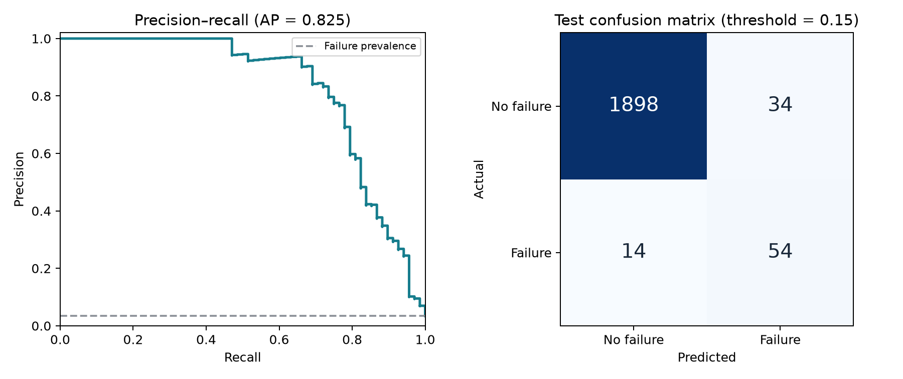
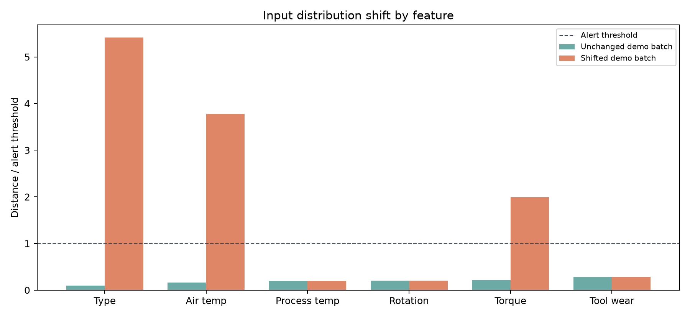

# Bằng chứng cho báo cáo project

Tệp này được tạo bằng `python -m predictive_maintenance.report` từ dữ liệu, mô hình và báo cáo giám sát của project. Chạy lại lệnh đó sau khi `dvc repro` và hai lô demo đã được tạo để cập nhật số liệu.

## Nguồn dữ liệu và thiết kế đánh giá

- Dataset: [AI4I 2020 Predictive Maintenance](https://archive.ics.uci.edu/dataset/601/ai4i), DOI [10.24432/C5HS5C](https://doi.org/10.24432/C5HS5C), dữ liệu mô phỏng, giấy phép CC BY 4.0.
- SHA-256 của CSV gốc: `dc6630cd9b1f0f853922fad78a1b6436570d3f1ec863f1dd5c4340ac56bc8a8e`.
- Tổng số bản ghi: **10,000**; tỷ lệ hỏng: **3.39%**.
- Chia stratified với seed **42**: train **6,400**, validation **1,600**, test **2,000**.
- Chỉ dùng sáu đặc trưng đầu vào; bỏ `UID`, `Product ID` và các nhãn nguyên nhân hỏng (`TWF`, `HDF`, `PWF`, `OSF`, `RNF`) để tránh rò rỉ nhãn.
- Chọn mô hình bằng average precision trên validation; chọn ngưỡng cảnh báo bằng F2 trên validation; test chỉ dùng để báo cáo mô hình đã chọn.

## So sánh mô hình trên validation

| Mô hình | PR-AUC | Precision | Recall | F2 |
| --- | ---: | ---: | ---: | ---: |
| logistic_regression | 0.420 | 0.285 | 0.685 | 0.535 |
| random_forest | 0.712 | 0.440 | 0.815 | 0.696 |
| xgboost | 0.780 | 0.581 | 0.796 | 0.741 |

## Kết quả mô hình được chọn trên test

Mô hình: **xgboost**, ngưỡng: **0.15**. PR-AUC **0.825**, ROC-AUC **0.974**, precision **0.614**, recall **0.794**, F1 **0.692**, F2 **0.750**.

| Thực tế / dự đoán | Không hỏng | Hỏng |
| --- | ---: | ---: |
| Không hỏng | 1898 | 34 |
| Hỏng | 14 | 54 |

## Demo giám sát dữ liệu đầu vào

Mốc tham chiếu gồm **6,400** bản ghi train. Mỗi lô demo có **500** bản ghi từ phần dữ liệu giữ lại. Lô dịch chuyển được tạo bằng cách cộng 5 K vào nhiệt độ không khí, cộng 10 Nm vào mô-men xoắn và đặt 60% bản ghi thành loại H.

| Đặc trưng | Lô bình thường | Lô dịch chuyển | Ngưỡng | Cảnh báo lô dịch chuyển |
| --- | ---: | ---: | ---: | --- |
| Type | 0.009 | 0.541 | 0.10 | Có |
| Air temp | 0.033 | 0.756 | 0.20 | Có |
| Process temp | 0.038 | 0.038 | 0.20 | Không |
| Rotation | 0.040 | 0.040 | 0.20 | Không |
| Torque | 0.042 | 0.399 | 0.20 | Có |
| Tool wear | 0.057 | 0.057 | 0.20 | Không |

Lô bình thường: **ok**. Lô dịch chuyển: **alert** với các đặc trưng được đánh dấu: **Type, Air temperature [K], Torque [Nm]**. Các giá trị trong bảng là khoảng cách total variation cho `Type` và thống kê KS cho đặc trưng số; đặc trưng số còn phải có p-value < 0,01 mới phát cảnh báo.

## Môi trường và giới hạn

Python 3.13.12; scikit-learn 1.9.1; XGBoost 3.4.1; MLflow 3.18.0.

AI4I là dữ liệu mô phỏng. Nhãn mô tả máy hỏng **tại bản ghi hiện tại**, không đo thời gian còn lại trước khi hỏng. Cách chia stratified không chứng minh khả năng dự báo theo thời gian trên máy thật. Ngưỡng drift là ngưỡng demo; thay đổi phân phối đầu vào không tự chứng minh hiệu năng mô hình đã giảm. Muốn đo hiệu năng khi triển khai cần thu thập nhãn thực và đánh giá theo thời gian.
