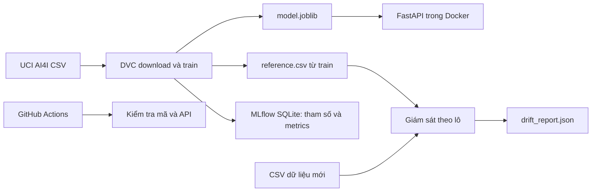

# Khung báo cáo cuối kỳ

## Nhóm thực hiện

| Mã số sinh viên | Họ và tên |
| --- | --- |
| 20250386E | Lương Trung Kiên |
| 20241617E | Hà Vĩnh Phước |
| 20260079E | Nguyễn Văn Tuấn Tú |

Đây là ghi chú làm việc cho nhóm. Các số liệu, bảng và hình đã kiểm chứng nằm trong [evidence.md](evidence.md); khi thay đổi pipeline, chạy lại lệnh xuất bằng chứng trước khi viết bản nộp.

## 1. Đặt vấn đề và mục tiêu

- Bài toán: phân loại trạng thái hỏng máy tại một bản ghi cảm biến của bộ dữ liệu AI4I 2020.
- Mục tiêu MLOps: tái tạo dữ liệu và huấn luyện, theo dõi thí nghiệm, đóng gói API, kiểm tra tự động và phát hiện thay đổi phân phối đầu vào.
- Phạm vi: demo trên dữ liệu mô phỏng; không dự báo remaining useful life và không triển khai ở nhà máy thật.

## 2. Dữ liệu và phương pháp

- Nguồn: UCI AI4I 2020, DOI 10.24432/C5HS5C, CC BY 4.0. SHA-256 của tệp CSV ở `evidence.md`.
- Sáu đặc trưng đầu vào và nhãn `Machine failure`; loại bỏ định danh và năm nhãn nguyên nhân hỏng để tránh rò rỉ.
- Chia stratified 64% train, 16% validation, 20% test với seed 42. Nêu rõ đây không phải kiểm chứng dự báo theo chuỗi thời gian.
- Ba mô hình: Logistic Regression, Random Forest, XGBoost. Chọn mô hình theo PR-AUC trên validation; chọn ngưỡng theo F2 trên validation vì lỗi hỏng hiếm và muốn ưu tiên recall.
- Bảng kết quả và hình PR curve, ma trận nhầm lẫn lấy từ `evidence.md`.

## 3. Kiến trúc và quy trình vận hành

- DVC lưu định nghĩa pipeline và hash sản phẩm trong `dvc.lock`; cache hiện ở máy cục bộ, chưa có remote DVC. Người clone repository chạy `dvc repro` để tải lại dữ liệu từ UCI và huấn luyện.
- MLflow ghi thí nghiệm trong SQLite cục bộ; Git không chứa database MLflow hay mô hình nhị phân. Mô hình được chọn được lưu trong MLflow run và xuất ra artifact cho API.
- Docker image chỉ chứa các thư viện cần cho API, dùng XGBoost CPU. API có `/health` và `/predict`.
- Giám sát so sánh dữ liệu mới với tập train; báo cáo `ok` hoặc `alert` theo từng đặc trưng và kiểm tra giá trị không hợp lệ.

## 4. Thực nghiệm và kết quả

- Bảng so sánh ba mô hình trên validation trong `evidence.md`.
- PR-AUC, precision, recall, F1, F2, ROC-AUC, ma trận nhầm lẫn của XGBoost trên test trong `evidence.md`.
- Demo drift: một lô 500 bản ghi giữ nguyên và một lô 500 bản ghi được cố ý thay đổi ba đặc trưng. Dùng bảng và hình trong `evidence.md`.
- Demo tái tạo: `dvc repro` → MLflow UI → Docker API → lệnh monitor → `python -m predictive_maintenance.report`.

## 5. Thảo luận và giới hạn

- Tỷ lệ hỏng thấp, vì vậy accuracy đơn lẻ không đủ để đánh giá khả năng phát hiện lỗi.
- Bộ dữ liệu mô phỏng và nhãn hỏng tại thời điểm hiện tại; kết quả không chuyển trực tiếp sang máy thật hay dự báo trước một khoảng thời gian.
- Ngưỡng drift là ngưỡng minh họa. Drift đầu vào chưa chứng minh chất lượng mô hình giảm; cần nhãn thật và giám sát precision/recall theo thời gian.
- Chưa có lịch tự động huấn luyện lại, DVC remote, máy chủ MLflow chung hoặc triển khai API công khai. Đây là các hướng mở rộng nếu môn học yêu cầu.

## 6. Nguồn tham khảo

- [UCI AI4I 2020 Dataset](https://archive.ics.uci.edu/dataset/601/ai4i).
- [MLflow Experiment Tracking](https://mlflow.org/docs/latest/tracking/).
- [DVC User Guide](https://doc.dvc.org/user-guide).
- [XGBoost Installation Guide](https://xgboost.readthedocs.io/en/latest/install.html).
